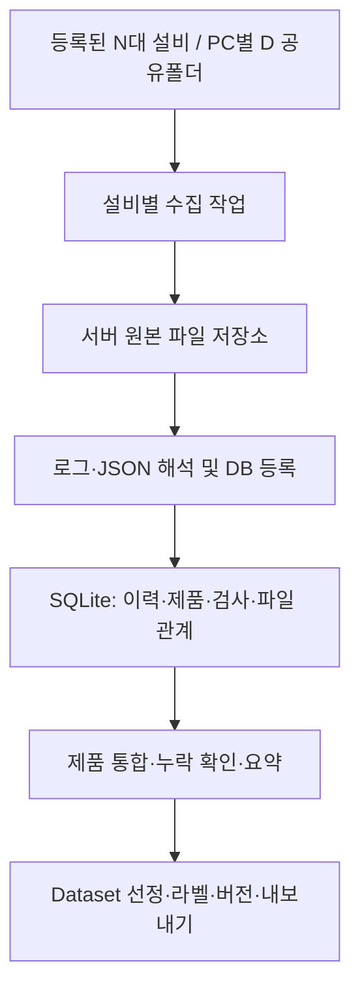

# MLCC 트리밍 설비 데이터 수집·제품 통합·Dataset 생성 시스템 구현 초안

| 항목 | 내용 |
|---|---|
| 문서 버전 | v0.3 |
| 작성일 | 2026-10-26 |
| 상태 | 구현 검토용 초안 — 실기 검증 전 |
| 최종 목적 | AI 학습 및 품질·공정 분석용 Dataset 생성 |
| 우선순위 | 설비 영향 최소화 → 원본 누락 방지 → 제품 연결 → Dataset 생성 |
| 적용 대상 | 트리밍기 N대(설정으로 가변, 초기 계획 9대), 설비당 제어 PC 1대·검사 PC 2대, 중앙 서버 1대 |

## 1. 설계 목표와 범위

각 설비에서 분산 생성되는 제어 로그, 검사 이미지, 검사 Metadata를 중앙 서버로 수집한다. 원본을 보존하면서 제품 식별자로 연결하고, 품질이 확인된 자료를 AI 학습·평가·분석에 사용할 수 있도록 Dataset으로 구성한다.

핵심 완료 기준은 다음과 같다.

1. 서버 장애나 수집 실패가 설비의 검사·제어 응답 대기로 전파되지 않는다.
2. 파일이 수집되지 않았거나 해석에 실패하면 해당 상태를 확인하고 재처리할 수 있다.
3. 통바의 가공·열화상과 분할바의 Side 검사 결과를 공통 ID로 추적할 수 있다.
4. Dataset에 포함된 원본·라벨·선정 조건·분할 정보를 보존하여 재현할 수 있다.

1차 구현은 원본 수집, SQLite 등록, 제품별 통합, 보관 관리, 기본 Dataset 내보내기를 포함한다. 모델 학습 엔진, 모델 배포, 불량 원인 자동 추론, MES/이전 공정 데이터의 실제 연결은 후속 범위로 둔다. 수집 시스템은 설비 안전·운전 제어를 대신하지 않는다.

## 2. 확정 사항과 제안 사항

### 2.1 대화에서 확정한 기준

| 구분 | 기준 |
|---|---|
| PC 구성 | 설비당 제어 PC 1대 + 검사 PC 2대. 설비 수 N은 설정으로 가변, 기본 PC 수는 3N대. 초기 계획 9대/27대 |
| 검사 역할 | 검사 PC별 열화상·컬러·Side 분담은 미정 |
| 설비 저장장치 | C: OS·실행 프로그램, D: 생산 데이터. 서로 다른 물리 저장장치 |
| D 저장매체 | SSD/HDD 미정 |
| 로컬 경로 | 날짜·시간별 폴더에 저장 |
| 통신 | 사내망, SMB 공유폴더, 서버 PULL |
| 실시간성 | 필수 아님. 하루 1회라도 정확하게 수집하는 것이 우선 |
| 원본 종류 | 제어 .log, 검사 PNG·TIFF, JSON Metadata |
| 용량 산정 기준 | 통바당 총 200MB, 설비당 120초/장. 9대는 계산 예시이며 설비 목록에서 대수를 산출 |
| 보관 방향 | 전체 이미지 30일, NG·특이 이미지 추가 보존 |
| 장기 저장 위치 | 우선 중앙 서버 내부 저장장치 사용, NAS 제외 |
| 처리 방식 | 하나의 수집 프로그램에서 파일 수집→해석→DB 등록까지 연속 실행 |
| 작업 관리 단위 | 설비 단위로 PC 3대를 관리 |

### 2.2 이번 초안의 제안 — 승인·검증 후 확정

| 항목 | 제안 |
|---|---|
| 서버 구현 | C#/.NET Windows Service + 관리 화면. 세부 .NET 버전은 사내 배포 정책으로 결정 |
| DB | SQLite를 서버 로컬 SSD에 배치, 이미지·원본 파일은 HDD |
| 병렬 수집 | 최대 3개 설비, 설비 내부 PC는 순차 처리. 동시성 1부터 시험 가능 |
| DB 쓰기 | 프로세스 내 공통 비동기 잠금으로 짧은 쓰기 트랜잭션 직렬화 |
| 기본 예약 | 매일 1회 전일·미완료 기간 수집. 실행 시각은 현장 협의 |
| 빠른 확인 옵션 | 1~5분 주기 설정 지원, 기본 비활성 |
| 복구 점검 | 서버 시작·일일 작업 시 미완료 복구, 정기 전범위 대조 |
| 학습 보존 | NG·특이 외 대표 OK 및 Dataset 사용 원본도 보호 |

## 3. 전체 구조와 책임



논리 기능은 분리하되 처음부터 여러 서비스·메시지 브로커로 나누지 않는다. 한 Windows Service 내 모듈로 구현한다. 조회 UI는 서비스가 사용하는 DB 파일을 외부 PC에서 직접 열지 않고 서버 API를 호출한다.

| 모듈 | 책임 |
|---|---|
| Scheduler | 자동·수동 실행, 설비 중복 실행 방지, 취소·재개 |
| EquipmentCollector | PC별 경로 확인, 목록 대조, 파일 복사·검증 |
| LogImporter / MetadataImporter | 서버 원본 해석, 스키마·ID 검증, 등록 데이터 생성 |
| DatabaseAccess | 쓰기 잠금, 트랜잭션, 고유 제약, 진행 위치 저장 |
| ProductIntegrator | 부모·자식·검사 연결, 완전성 확인, 요약 갱신 |
| RetentionManager | 일반 이미지 만료·보존 지정·위치·삭제 이력 |
| DatasetBuilder | 대상 선정, 그룹 분할, 라벨 버전, 원본 보호, 내보내기 |
| ManagementApi / UI | 상태 조회, 수집 명령, 제품 조회, 보존·Dataset 관리 |

설비 측은 공통 ID·Metadata·저장 완료 기준을 제공한다. 대용량 수집·DB 등록·통합·Dataset 생성은 서버에서 수행한다. 설비 제어 PC가 검사 PC 파일까지 모아서 서버에 보내는 구조는 사용하지 않는다.

## 4. 용량과 처리량 기준

MB·TB는 십진수이며 24시간 연속 가동 가정이다. 200MB는 통바 1장에 대해 PC 3대에서 발생하는 합계의 용량 계획값이다. 제어 로그·추가 처리 이미지가 이 값에 포함되는지는 샘플로 확인한다.

| 항목 | 설비 1대 | 설비 9대 |
|---|---:|---:|
| 시간당 통바 | 30 | 270 |
| 일 통바 | 720 | 6,480 |
| 일 분할바 | 2,880 | 25,920 |
| 시간당 데이터 | 6GB | 54GB |
| 일 데이터 | 144GB | 1.296TB |
| 평균 데이터 속도 | 약 1.67MB/s | 15MB/s |
| 30일 데이터 | 4.32TB | 38.88TB |

최근 30일분 38.88TB를 저장하면서 볼륨 20%를 비워 두려면 최소 48.6TB가 필요하다. 30일을 지난 NG·특이·대표 OK·Dataset 보호 자료, DB·로그·썸네일·백업 공간은 추가한다. 모든 자료를 영구 보존할 수 있다는 의미가 아니다.

일일 1.296TB 수집에 필요한 순수 전송 시간 예시는 30MB/s에서 약 12시간, 60MB/s에서 약 6시간이다. 이는 서버 전체의 실효 속도이며 디렉터리 탐색·검증·DB 등록 시간은 별도다. 하루 한 번 예약하더라도 수집이 24시간 이내 밀리지 않고 마무리되는지 검증한다.

보존 비율은 NG 제품 개수 비율이 아닌, 부모 열화상·재검사 등 연관 파일을 포함한 실제 바이트 비율로 측정한다.

## 5. 설비 측 저장 인터페이스

### 5.1 PC와 검사 기능 분리

MachineId는 TRIM01 같은 설정값이며 TRIM09로 상한을 제한하지 않는다. SourcePcId는 CTRL01/VISION01/VISION02 같은 설정값을 사용한다. Thermal·Color·Side는 데이터 종류이며 PC 번호에 고정하지 않는다. 한 PC가 여러 데이터 종류를 생성해도 같은 규약으로 수집한다.

### 5.1.1 설비 수 가변 적용

- 설비 목록과 PC 목록을 설정/DB로 관리하고, 화면·스케줄러·이력·통계는 등록 목록으로 생성한다. 9개 버튼·27개 연결·고정 배열을 코드에 넣지 않는다.
- 설비 수는 활성 Equipment 개수, 접속 대상 수는 활성 SourcePc 개수로 산출한다. 별도의 EquipmentCount 숫자와 목록을 이중 관리하지 않는다.
- 설비 추가는 고유 MachineId, 표시 이름, PC 목록, UNC 공유 경로, 저장 규약 프로필을 등록하는 작업이다. 기존 설비의 ID·데이터는 유지한다.
- 설비 사용 중지는 신규 예약만 중지하고 실행 중 작업은 안전하게 종료/취소한다. 과거 데이터·Hold·Dataset 참조를 삭제하지 않는다.
- 설정 변경은 검증 후 다음 실행에 반영한다. 초기 구현은 서비스 재시작 적용을 허용하고, 무중단 적용은 후속 기능으로 둔다.
- 동시 실행 상한·대역은 설비 수와 독립된 설정이다. 설비가 늘어도 스레드·전송을 무제한 늘리지 않는다.
- 기본 구성은 PC 3대지만 스키마는 PC 목록 형태로 둔다. PC 추가가 가능한 구조와 실제 추가 PC 역할 지원 여부는 구분한다.
- 등록 설비 수에는 9대 고정 제한을 두지 않되 실제 지원 처리량은 네트워크·디스크·일일 처리시간의 실측으로 정한다.

용량 계획식(연속 가동, 통바 200MB/120초): N대의 일 발생량 = 0.144N TB, 최근 30일 = 4.32N TB, 평균 유입량 = 1.667N MB/s. 20% 여유를 유지하는 최근 30일 필요 공간 = 5.4N TB이며 선택 보존·백업 등은 추가한다. 운영 중에는 PC별 실제 발생량으로 보정한다.

### 5.2 로컬 경로 예시

```text
D:\ProductionData\2026-10-26\14\
  control\TRIM01_CTRL01_20261026_14_001.log
  table\PARENT001\BUNDLE_TABLE_001\
    images\IMG001.tiff
    table_metadata.json
    manifest.json
    complete.marker
  side\Q001\INS001\BUNDLE_SIDE_001\
    images\IMG101.png
    inspection_metadata.json
    manifest.json
    complete.marker
```

위 경로는 협의용 예시이며, 실제 구조는 다음 조건을 만족하도록 확정한다.

- 날짜·시간 폴더의 기준은 시작 시각 등 하나로 통일한다. 시간 경계를 넘는 작업도 같은 Bundle에 유지하고 저장 중 묶음을 분할하지 않는다. 구체 기준과 한국 시간대 표기를 PC 간 통일한다.
- 제품·검사 ID는 파일명 또는 Metadata에 포함한다. 경로만으로 제품 의미를 추측하지 않는다.
- 파일·Bundle 이름은 재부팅·재투입 이후에도 충돌하지 않는다.
- Metadata의 이미지 경로는 Bundle 기준 상대경로를 권장한다.
- 날짜·시간 폴더를 만든 것과 파일 저장 완료는 별개다.

### 5.3 저장 완료 계약

이미지·JSON은 임시 파일로 기록→쓰기 종료→최종 이름으로 변경한다. Bundle의 실제 목록과 상태를 manifest에 확정하고 완료 마커를 마지막에 게시한다. 게시 후 내용은 불변으로 취급한다. 수정이 필요하면 새로운 BundleId 또는 Revision을 발행한다.

완료 마커는 두 의미를 구분한다. '게시 완료'는 더 이상 쓰지 않는다는 뜻이며, '정상·부분실패'는 manifest의 BundleStatus로 구분한다. 일부 이미지가 저장 실패한 묶음도 실패 목록을 포함해 확정·게시할 수 있어야 한다. 그렇지 않으면 누락 원인 자체가 서버에 전달되지 않는다.

검사 결과 통신 완료와 파일 저장 완료는 분리한다. 제어·검사 스레드는 서버 ACK를 기다리지 않는다. 비동기 저장 Queue 포화·로컬 디스크 부족 시 운전 지속/정지 정책은 별도 협의한다.

### 5.4 로그 파일

표준 로그의 기본 로컬 루트는 `D:\Log\Standard`이며 아래에 yyyyMMdd 일자 폴더(예: 20261026), 다시 시간별 폴더를 두어 저장합니다.

```text
D:\Log\Standard\20261026\<시간폴더>\<로그파일>.log
```

시간 폴더의 정확한 이름은 미정입니다. 00~23 형식은 가정하지 않습니다. 루트·세부 패턴은 PC별 설정으로 변경하고 일→시간 계층을 유지합니다. 이 경로는 표준 로그에만 적용하며 검사 이미지·JSON 경로는 별도입니다.

서버는 이 로컬 루트에 대응하는 UNC 공유 경로를 등록합니다. 폴더 시각은 탐색 범위에 사용하고 이벤트 시각은 로그 Datetime에서 읽습니다. 시간이 지났다는 이유만으로 파일 저장 완료로 판단하지 않습니다. 과거 날짜·시간 폴더도 재점검해 지연 추가·미수집 파일을 찾습니다.

앞의 ProductionData 경로는 통합 예시이며 표준 로그 실제 기본 경로를 대체하지 않는다.

제어 로그는 SEM_LOG 2.0의 11개 컬럼을 유지한다. Level은 실제 로그에 추가하지 않는다. 시간별 파일 롤링과 명시적 닫힘 표시를 권장한다. 전시간 폴더라도 닫힘 확인 전에는 확정 파일로 보지 않는다.

1차는 닫힌 파일만 수집한다. 계속 추가되는 파일의 tail 수집은 파일 세대·잘림·교체·바이트 Offset을 다뤄야 하므로 별도 기능으로 분리한다. '파일 크기가 잠시 변하지 않음'만으로 완료를 보장하지 않는다.

## 6. 공통 식별자와 귀속

| 식별자 | 의미 |
|---|---|
| MachineId / SourcePcId | 설비와 실제 발생 PC |
| LotId / TrayId | MES 생산·물류 식별 |
| TrayLoadId | 동일 Tray의 투입 회차 구분 |
| ParentProductId | 통바 형상 이송·가공 단위 |
| ProductId / QuarterNo | 개별 분할바와 부모 내 위치 |
| InspectionId | 한 검사 작업. 종료 후 별도 재검사는 새 ID |
| AttemptNo | 같은 검사 작업 내 최초·조건부 재검사 구분 |
| ImageId / BundleId | 이미지·저장 묶음의 고유 식별 |
| ExecId / ParentExecId | 제어 동작 실행과 상하 관계 |

제어 PC가 제품·검사 식별자를 생성·전달하고 검사 PC가 그대로 보존한다. 서버는 시각이 가깝다는 이유만으로 다른 PC의 자료를 같은 제품으로 확정 연결하지 않는다. 원래 Quarter 방향이 불확실하면 임의의 QuarterNo를 만들지 않는다.

Table 컬러·열화상·가공은 ParentProductId, Side는 ProductId+InspectionId 기준이다. 분할바 네 개는 같은 부모 Table 파일을 참조하며 원본을 네 번 복제하지 않는다. 공통 Alarm의 시간 중첩은 참고 연관이지 불량 원인 확정이 아니다.

## 7. 정기 수집·대조 알고리즘

### 7.1 설비 단위 실행

설비 단위 잠금을 얻고 CTRL→VISION01→VISION02 순서로 진행한다. 동일 설비의 자동·수동·재점검은 중복 실행하지 않는다. 최대 동시 설비 수는 설정값이다. 초기 3개는 제안이며 실기 검증 결과 1~3 등으로 조정한다.

한 PC의 접속 실패는 유한한 Timeout·재시도 후 기록하고 다음 PC로 넘어간다. 파일 오류도 다른 파일을 막지 않는다. SMB 열거·복사의 실제 중단 가능 여부를 구현 단계에서 확인하며 취소 토큰만으로 OS I/O가 즉시 중단된다고 가정하지 않는다.

### 7.2 확인 범위

일일 실행은 전일 폴더와 이전 미완료 기간을 확인한다. 시작 시 서버의 Interrupted·RetryPending 상태를 복구한다. 현재 시간 폴더를 수동으로 수집하더라도 게시 완료된 파일만 처리한다.

오래된 폴더에 파일이 늦게 추가될 수 있으므로 마지막 시각 이후만 영구 확인하는 방식은 금지한다. 매일 또는 별도 설정 주기로 로컬 보존 범위 전체를 대조하되, PC별로 분산하고 검색·전송 부하를 제한한다. 전체 목록 대조는 전체 파일 재복사를 의미하지 않는다.

### 7.3 파일 단위 처리

1. 공유폴더에서 확정 Bundle/닫힌 로그 목록을 얻는다.
2. SourcePcId+정규화 상대경로+불변 Revision으로 서버 이력과 대조한다.
3. 완료 이력이 있으면 건너뛴다. 미수집은 복사, 수집 완료·등록 실패는 서버 원본 재처리로 분기한다.
4. 서버 대상 볼륨의 여유 공간을 확인한다.
5. 서버의 대상 볼륨 내 임시 이름으로 속도 제한 복사한다.
6. 목록·바이트 수·체크섬 계약에 따라 검증한다.
7. 최종 경로로 rename한 뒤 수집 완료 이력을 확정한다.
8. 서버 원본을 해석하고 짧은 트랜잭션으로 상세 데이터·등록 상태를 반영한다.
9. 영향을 받은 제품 ID를 통합 대상으로 표시한다.
10. 다음 파일로 진행하고 마지막에 설비별 결과를 집계한다.

Bundle 전체 원본이 확보되었는지와 개별 파일의 성공은 각각 추적한다. 같은 경로의 내용 변경을 발견하면 덮어쓰지 말고 SourceChanged/Conflict로 분리한다. 수정된 파일을 정상 중복으로 취급하지 않는다.

### 7.4 부하 제한

PC당 파일 전송 1개, 전체 동시 설비 수·전체 전송 대역·PC별 대역을 제한한다. DB 잠금을 잡은 채 네트워크 접근·복사·해시·파일 파싱을 하지 않는다. 완료 마커·Metadata만 가볍게 열거하고 모든 이미지의 본문을 매 Scan 읽지 않는다.

데이터 NIC는 가능하면 EtherCAT·카메라 취득용 NIC와 분리한다. 별도 NIC라도 CPU·메모리·드라이버·버스 자원은 공유하므로 무영향을 보장하지 않는다. 추가 NIC 필요 여부는 실제 카메라·모션 구성에 따라 결정한다.

### 7.5 무결성 수준

파일 수·크기 확인은 필수지만 동일 크기의 내용 손상은 검출하지 못한다. Dataset 원본의 강한 검증에는 SHA-256 같은 체크섬을 사용한다. 생산 PC가 저장 시 스트리밍으로 계산한 해시를 manifest에 제공하고 서버 복사 스트림에서 계산·대조하는 방식을 우선 검토한다.

설비 해시 제공이 어렵다면 서버에서 계산한 해시는 이후 서버 파일 변조·손상 확인 기준으로만 사용한다. 그것만으로 원본과 동일함을 입증할 수는 없다. 원본 전체를 추가로 읽는 해시 검증은 설비 부하를 늘리므로 별도 승인된 저부하 시간의 점검으로 적용한다. PC별 VerifyLevel을 기록하고 검증 수준이 낮은 자료를 숨기지 않는다.

## 8. 서버 파일 배치와 DB 구성

### 8.1 서버 경로 예시

```text
C:\TrimDataServer\               서비스·설정
C:\TrimDataServer\Db\main.db     로컬 SSD의 SQLite
E:\Raw\TRIM01\CTRL01\2026-10-26\14\...
E:\Raw\TRIM01\VISION01\2026-10-26\14\...
F:\Raw\TRIM02\VISION02\2026-10-26\14\...
E:\Datasets\DS_SIDE_001\v001\...
```

이미지 등 원본은 HDD 파일로 보관하고 DB에는 StorageRootId+RelativePath를 저장한다. E/F 같은 실제 드라이브는 설정에서 해석한다. 개별 HDD 볼륨을 추가해도 DB의 논리 참조를 유지한다. RAID 사용 여부·HDD 개수는 별도 하드웨어 결정이며 RAID도 백업을 대신하지 않는다.

### 8.2 SQLite 운용

WAL 모드, 외래키 활성화, 쓰기 대기 Timeout을 적용한다. 내구성 우선으로 synchronous=FULL을 초기 검토값으로 두고 측정 후 결정한다. 네트워크 공유상의 DB 직접 사용은 금지한다. Windows Service 인스턴스는 서버당 하나로 제한한다.

파일 복사는 병렬 가능하나 모든 DB 변경은 DatabaseAccess를 경유한다. 공통 SemaphoreSlim은 짧은 쓰기 트랜잭션에만 적용한다. 프로세스 밖의 직접 쓰기를 허용하지 않으며 잠금 오류는 유한 재시도한다. 읽기는 별도 연결과 페이지 조회를 사용하고, 장시간 열린 조회 트랜잭션으로 WAL Checkpoint가 지연되지 않도록 한다.

등록 자료 전체를 메모리에 올리지 않는다. 로그는 스트리밍 파싱·제한된 배치로 반영한다. WAL 크기·Checkpoint·DB 증가량·디스크 여유를 감시한다. 운영 DB는 SQLite 백업 API 등 일관성 있는 방식으로 백업하고, 사용 중인 main.db만 복사하지 않는다.

## 9. DB 테이블 초안

아래는 논리 설계이며 최종 DDL·인덱스는 샘플 데이터로 검증한다. 모든 크기는 64비트 정수로 다룬다. 시간은 UTC를 정규화 값으로 저장하고 원본 시각·시간대도 보존한다.

| 테이블 | 주요 필드 | 목적·제약 |
|---|---|---|
| Equipment / SourcePc | MachineId, PcId, RoleTags, ShareRoot, Enabled | 설비·접속 경로, 검사 역할 설정 |
| CollectionRun | RunId, Trigger, Start/End, 범위, 결과 | 자동·수동·재점검 실행 이력 |
| CollectedFile | FileId, PcId, SourceRelativePath, Revision, Size, Hash, StorageRootId, RelativePath, CollectState, ImportState | 원본 수집·등록 상태. 원본 키에 UNIQUE |
| DataBundle / BundleFile | BundleId, PcId, 상태, 예상·실제 목록, FileId | 여러 파일의 묶음·누락 판단 |
| ImportError | FileId, LineNumber/JsonPath, Code, Message, ParserVersion | 해석 오류를 원본 위치와 연결 |
| ParentProduct | MachineId, ParentProductId, TrayLoadId, InputForm | 통바 형상 단위 |
| Product | MachineId, ProductId, ParentProductId, QuarterNo, LifecycleStatus | 분할바와 부모 연결 |
| OperationEvent | EventId, FileId, LineNumber, 시각, MachineId, ProductId, ExecId, Scope, OperationName, Status, Data | 필요한 제어 로그 상세. FileId+LineNumber UNIQUE |
| Inspection | MachineId, InspectionId, ProductId, FinalJudge, AlgorithmVersion, 상태 | 검사 작업. MachineId+InspectionId UNIQUE |
| InspectionImage | ImageId, InspectionId/ParentProductId, Point/Side/Attempt, ImageType, FileId | 촬영 의미와 원본 파일 연결 |
| Measurement | InspectionId, Side/Point/Attempt, Metric, Value, Unit, Rule, Judge | 개별 측정값·당시 기준 |
| ProductSummary | ProductKey, 대표 판정·수치, 수량, CompleteState, MissingReasons | 제품 목록 조회용 한 행 |
| RetentionHold | HoldId, TargetType/Id, Reason, Owner, Expiry/Released | 장기 보존·Dataset 보호 |
| LabelRevision | LabelId, TargetId, Revision, Label, Reviewer, Reason | 설비 판정과 분리된 학습 라벨 |
| DatasetVersion / DatasetSample | VersionId, RuleSnapshot, SourceIds, LabelRevisionId, Split, Hash | 고정 Dataset 명세 |
| StorageVolume / DeletionAudit | 볼륨 용량, 대상, 단계, 사유, 실행 결과 | 용량·삭제·복구 추적 |

다중 Metric은 행으로 저장한다. 8~20Point를 Point1~Point20 고정 열로 펼치지 않는다. 원본 JSON은 파일로 남기고, 검색·통합에 필요한 필드를 구조화한다. 가변 제조사 확장값은 보조 JSON 필드로 보존할 수 있다.

ID가 전역 고유라는 전제에 의존하지 않고 MachineId와 조합해 교차 설비 충돌을 방지한다. 동일 InspectionId가 두 PC에서 발견되면 정상 분담인지 중복·충돌인지 검사 계약으로 판단한다. 임의로 한쪽 결과를 덮어쓰지 않는다.

### 9.1 상태는 두 축으로 관리

| 축 | 상태 예시 |
|---|---|
| CollectState | Discovered, Copying, Verified, RetryPending, Conflict, SourceMissing |
| ImportState | NotApplicable, Pending, Importing, Completed, CompletedWithErrors, Failed |

이미지는 ImportState=NotApplicable로 처리하되 파일 수집 등록과 JSON 참조 연결은 수행한다. JSON이 먼저 오면 이미지 연결 대기, 이미지가 먼저 오면 의미 연결 대기로 둔다. 실패 상태와 실제 원본이 물리적으로 없는 상태를 구분한다.

### 9.2 트랜잭션과 재시작 복구

작은 JSON은 검사·측정값·참조 등록과 ImportState 완료를 같은 트랜잭션에서 확정한다. 큰 로그는 예를 들어 500행 단위로 반영하며 데이터와 처리 완료 줄/바이트 위치를 함께 커밋한다. 줄 수는 설명값이며 실측으로 조정한다.

복사 후 DB 기록 전 종료된 파일은 서버 임시·최종 파일과 이력을 대조해 회수한다. DB만 완료이고 파일이 없으면 Missing으로 표시한다. Importing에서 중단된 항목은 마지막 커밋 위치부터 재개한다. 파일 크기·해시가 다르면 이전 Offset을 재사용하지 않는다.

## 10. 제품별 통합

파일 등록 후 변경된 제품 ID를 모아 주기적 또는 수집 실행 끝에 통합한다. 별도 프로세스는 필요하지 않다. 통합 작업도 공통 DB 쓰기 규칙을 따른다. 통합이 오래 걸리면 작은 작업 단위로 나누고 원본 수집을 우선한다.

1. Parent와 Product 관계를 제품 등록 로그·Metadata에서 연결한다.
2. Table 촬영·CutPlan·실제 가공 정보는 Parent에 귀속한다.
3. Side 검사·Attempt·측정값·이미지는 Product+InspectionId에 귀속한다.
4. 시간 순서의 공정·검사·배출 이력을 구성한다.
5. 제품별 필수 항목과 실제 존재 항목을 대조한다.
6. ProductSummary를 재생성하거나 갱신한다.

### 10.1 완료 기준

| 상태 | 의미 |
|---|---|
| Waiting | 다른 PC의 데이터가 아직 도착하지 않음 |
| Complete | 해당 공정 경로에서 요구되는 정보·파일이 확인됨 |
| Partial / ReviewRequired | 저장 실패·누락·충돌·미판정 등 확인 필요 |
| NotApplicable | 해당 검사·공정이 실제로 생략된 조건 |

통바당 무조건 고정 이미지 수를 요구하지 않는다. FullBar/QuadBar, 생성된 처리본, 실제 Retry, 카메라 구성에 따른 기대 목록은 manifest·Metadata에 근거한다. 중도 배출·미검사 제품은 정상 완료 제품과 다른 필수 항목을 적용한다. 시간 경과만으로 Complete로 올리지 않는다.

14시 가공·15시 검사처럼 시간 폴더가 달라도 ID로 연결한다. 완전한 자료만 분석·학습에 사용하도록 기본 필터를 제공하되, 누락 자체를 연구할 때는 별도 Dataset 정책으로 명시적으로 허용한다.

## 11. 30일 보관과 선택 보존

일반 이미지는 촬영 시각 기준 30일 후 정리한다. 지연 수집 시 수집 직후 삭제되는 것을 막기 위해 '수집 검증 완료 후 최소 유예기간'도 충족해야 한다. 유예기간 값은 미정이다. 원본 로그·JSON·측정값의 보존기간은 이미지와 별도 설정한다. 영구 무제한 보관으로 간주하지 않는다.

| 보존 사유 | 기본 범위 |
|---|---|
| 최초/최종 NG, Retry NG | 해당 분할바의 최초·재검사 원본, Metadata, 부모 Table 자료 |
| 특이 조건 | 미판정·검출 실패·기준 근접·신규 결함 등 설정 조건 |
| 대표 OK | Lot·Recipe·두께·시점·수치 구간별 표본 |
| 수동 보존 | 지정자가 선택한 제품·검사·이미지 |
| Dataset 사용 | 명세가 참조하는 원본·라벨·재생성에 필요한 자료 |

최초 NG 후 재검사 최종 OK도 학습 가치가 있으므로 최종 NG만으로 선별하지 않는다. 한 파일이 여러 제품·Dataset에 참조되면 모든 보호가 해제되기 전 삭제하지 않는다. 부모 파일도 자식의 보존 관계를 따른다.

삭제는 후보 목록 생성→보존 참조 재확인→삭제 예약 기록→파일 삭제→DB 상태 확정 순서로 진행한다. 같은 파일의 Dataset 보호 생성과 삭제 예약은 트랜잭션으로 조정한다. 삭제 중인 원본은 Dataset에 새로 포함하지 않고 실패·재시도하도록 한다. 재시작 시 파일 유무와 삭제 이력을 대조한다.

공간 부족 시 미수집 원본·보호 파일을 조용히 삭제하지 않는다. 수집 대기·경고·잔여 일수를 표시하고 보관 정책 변경 또는 증설을 요청한다. 설비 로컬도 한계가 있으므로 로컬 디스크 부족은 별도의 운전 정책이 필요하다.

서버에서 수집 완료를 기록한 사실만으로 설비가 이를 알 수는 없다. 로컬 삭제 자동화에는 별도 ACK 전달 계약이 필요하다. 1차는 자동 로컬 삭제를 비활성화하고, 후속으로 별도 ACK 공유 경로 등 비동기 확인 방식을 협의한다. 제어·검사는 ACK를 기다리지 않는다.

## 12. Dataset 생성 기능

### 12.1 샘플 단위

관리·추적 기준은 ProductId다. 모델 입력은 목적에 따라 Point 이미지, ROI, 분할바 이미지 묶음 또는 Parent+Product 복합 샘플로 선택한다. 이미지 단위 라벨과 제품 단위 라벨을 혼동하지 않는다. 제품 NG라는 이유만으로 모든 Point 이미지에 NG 라벨을 자동 부여하지 않는다.

### 12.2 Dataset 생성 절차

1. 목적·샘플 단위·기간·설비·Lot·Recipe·InputForm·판정·측정 구간을 선택한다.
2. 수집·통합 상태, 이미지 존재·해시, 필수 Metadata를 확인한다.
3. 설비 판정은 원래 관측값으로 남기고 검토된 LabelRevision을 선택한다.
4. 정상·불량 비율과 조건별 대표성을 검토한다.
5. Group 단위로 Train/Validation/Test를 나눈다.
6. 선택된 원본을 보호하고 버전 명세를 확정한다.
7. 필요 시 학습 도구 형식으로 내보내고 결과를 검증한다.

Group의 최소 기준은 MachineId+ParentProductId로 둔다. 같은 통바에서 나온 분할바·Retry·파생 이미지는 서로 다른 Split에 두지 않는다. 실제 일반화 평가에는 Lot·생산일·설비 단위 분리도 목적에 맞게 적용한다. RandomSeed와 그룹·분할 정책을 기록한다.

### 12.3 Dataset 버전 명세

| 필드 | 내용 |
|---|---|
| DatasetId / Version | Dataset 고유 ID와 불변 버전 |
| Purpose / SampleUnit | 분류·검출·분석 등 목적, Point/ROI/Product |
| SelectionRule | 필터·기준·제외 조건 스냅샷 |
| SourceSnapshot | ProductId, InspectionId, ImageId, 파일 해시, Metadata 버전 |
| LabelRevision | 당시 검토 라벨과 근거 |
| Split / GroupKey | 학습·검증·평가 배정과 누출 방지 그룹 |
| Transform | ROI·크기 변경·정규화 등 처리 규약과 버전 |
| BuildVersion | 생성 코드·설정 버전, 생성자·시각 |
| ValidationReport | 누락·중복·비율·그룹 중첩 검사 결과 |

버전 확정 후 명세·라벨 선택·Split을 덮어쓰지 않는다. 수정은 새 버전으로 만든다. 기본 Dataset은 파일을 복제하지 않는 논리 명세다. 다른 학습 PC로 전달할 때는 이미지·라벨·manifest·checksum·README를 포함한 물리 Export를 별도로 만든다.

### 12.4 내보내기 예시

```text
Dataset_DS_SIDE_001_v001/
  dataset_manifest.json
  samples.csv
  labels.jsonl
  checksums.sha256
  validation_report.json
  README.md
  images/                     물리 내보내기 선택 시
```

CSV에는 1행당 샘플 키와 이미지 참조·라벨·Split을 기록한다. 다중 이미지 샘플은 배열을 담는 JSONL을 함께 제공할 수 있다. SAIGE 등 실제 학습 도구의 입력 형식은 제품 버전·API 확인 후 별도 Adapter로 구현한다. 이 초안은 특정 상용 도구의 포맷 호환을 보장하지 않는다.

## 13. 관리 화면

| 화면 | 표시·조작 |
|---|---|
| 설비 현황 | 등록된 설비별 PC 연결·마지막 성공일·미수집·오류·확인 불가 상태 |
| 수집 실행 | 지금 수집, 기간 재점검, 일시 중지·취소, 진행 바이트·속도 |
| 파일 오류 | 복사·무결성·파싱·ID 충돌 구분, 원본 경로, 재처리 |
| 제품 조회 | Parent/Product·Lot·시각 검색, 이미지·판정·측정·공정·누락 |
| 저장공간 | 볼륨별 여유·일 증가량·잔여 일수·보존 사유별 사용량 |
| 보존 관리 | NG·대표 OK·특이·수동·Dataset 보호, 해제·만료 |
| Dataset | 대상 미리보기, 라벨, 그룹 Split, 버전 확정·내보내기 |

PC 접근이 불가능한 기간은 미수집 건수를 정확히 알 수 없으므로 '0건'이 아닌 '확인 불가'로 표시한다. 원본 파일 자체를 설비가 생성하지 않은 문제는 수집 목록 대조만으로 알 수 없다. 생산 수량·이미지 기대 목록과의 제품 통합 검사가 이를 담당한다.

외부 2~3명 조회는 서버 API를 사용한다. 관리 명령과 일반 조회 권한을 구분하고 SMB 접속 계정은 원본 경로 읽기 전용으로 시작한다. 자격증명은 평문 설정에 넣지 않고 Windows 자격증명 관리 등 사내 승인 방식으로 처리한다.

## 14. 설정 항목 초안

| 그룹 | 주요 설정 |
|---|---|
| 설비·PC | Enabled, MachineId, PcId, ShareRoot, 데이터 종류, 보존 범위 |
| 예약 | DailyTime, ScanInterval, 수동 범위, 전체 재점검 주기 |
| 부하 | MaxConcurrentEquipments, PC별·전체 대역, 작업 간 대기 |
| 신뢰성 | 접속·읽기 Timeout, 최대 재시도, Backoff, 체크섬 수준 |
| 저장 | StorageRoot 우선순위, 최소 여유 공간, 용량 경고 |
| 등록 | 지원 SchemaVersion, ParserVersion, BatchSize |
| 통합 | 공정별 기대 자료, 지연 대기 기준, 충돌 정책 |
| 보관 | 일반 이미지 30일, 수집 후 유예, NG·OK 표본·Hold 정책 |
| Dataset | 라벨 체계, 샘플 단위, Group/Split 정책, Export 형식 |

설정 변경 이력을 남긴다. 부하·삭제·라벨·Dataset 관련 변경은 변경자·시각·이전값을 기록한다. 수동 '지금 수집'도 동일한 속도 제한을 사용한다.

## 15. 구현 순서와 단계별 납품물

| 단계 | 구현 | 완료 산출물 |
|---|---|---|
| 0. 계약 확인 | 샘플 로그·JSON·이미지 확보, ID·저장 완료·경로 확정 | 인터페이스 명세, 샘플, 검수 항목 |
| 1. 단일 PC 수집 | 날짜·시간 Scan, 임시 복사, 검증, 이력·재시도 | 1대 PC 복구 가능한 Collector |
| 2. 다설비 확장 | 설비 추가·중지·설정 기반 작업·동시성·대역 제한·수동·재점검 | N대 설비 등록 기능, 초기 9대/27PC 설정 예시, 수집 현황 |
| 3. DB 등록 | 로그·JSON 파서, 트랜잭션·중복 방지·오류 | SQLite 스키마·등록 모듈 |
| 4. 제품 통합 | 부모·자식·검사 연결, 누락, 요약·조회 | 제품 조회·통합 검증 보고 |
| 5. 보관 관리 | 30일·Hold·대표 OK·삭제 복구 | 보존 규칙·용량 화면·삭제 검수 |
| 6. Dataset | 라벨·선정·Group Split·불변 버전·Export | 학습 가능한 샘플 Dataset·명세 |

초기 성능 검증 없이 전체 PC 운영을 시작하지 않는다. 1개 PC→1개 설비→소수 설비→등록 설비 전체 순으로 확대한다. 초기 검증 목표는 9대/27PC이며 상한은 아니다. 세부 기간·인력·장비 발주는 미정이다.

## 16. 검증·수용 기준 초안

| 시험 | 합격 기준 |
|---|---|
| 설비 영향 | 수집 OFF/ON에서 최대 촬영·Retry 조건의 검사 시간, 저장 지연·Queue, 제어 주기·오류 비교. 허용 수치는 현장 합의 |
| 원본 정확성 | 테스트 manifest의 기대 파일 수·크기·해시와 서버 결과 일치 |
| 중복 재실행 | 동일 범위를 여러 번 실행해도 파일·이벤트·측정값 중복 없음 |
| 저장 중 접근 | 임시·미완료 파일은 확정 원본으로 등록하지 않음 |
| 지연 파일 | 과거 시간 폴더에 늦게 추가한 파일을 재점검으로 발견 |
| 단절·PC 정지 | 다른 PC 수집 계속, 실패 구간을 명시하고 복구 후 수집 |
| 서버 강제 종료 | 복사 중·rename 직후·등록 중 각 지점에서 재개, 정상 완료 오표시 없음 |
| 디스크 부족 | 부분 파일을 정상 선언하지 않고 원본 보호·경고·재시도 |
| 원본 변경 | 같은 경로의 다른 내용이 덮어써지지 않고 충돌로 표시 |
| 파서 오류 | 잘못된 줄·JSON의 위치·사유 확인, 서버 원본 재처리 가능 |
| 제품 연결 | 3개 PC·시간 경계·Retry 자료가 ID로 정확히 연결 |
| 삭제 보호 | 부모·Dataset 참조 중인 원본 삭제 방지, 삭제 중 종료 복구 |
| Dataset 분할 | 같은 Parent 그룹의 Train/Validation/Test 중복 0건 |
| 재현성 | 동일 버전의 ImageId·Hash·LabelRevision·Split 명세 불변 |
| 조회 동시성 | 2~3명 조회 중 수집 지속, 시간 초과·WAL 증가 확인 |
| 일일 처리량 | 1.296TB/일 계획량과 복구 적체를 현장 허용 부하 내 처리 |
| DB 복구 | 일관된 DB 백업에서 이력·제품·Dataset 복원 시험 통과 |
| 가변 설비 수 | 1대·9대·10대 이상 설정에서 코드 수정 없이 화면·예약 생성, 중지 설비의 과거 이력 유지. 처리량 상한은 별도 검증 |

스캔 성공만으로 '누락 0'을 보장하지 않는다. 생성 측 기대 목록·공정 수량, 로컬 존재 목록, 서버 수집 목록의 세 관점이 함께 맞아야 한다. 원본이 수집 전에 유실되거나 생성되지 않은 경우 복구 불가 상태를 명시한다.

## 17. 추가 확정 사항

1. 각 검사 PC의 실제 역할·카메라·물리 디스크·취득용 NIC 구성.
2. 실제 `.log` 헤더·인코딩·필드 Escape·시간별 닫힘 규약과 ID 값.
3. JSON SchemaVersion, Bundle 경계, 완료 마커, Partial 게시 계약.
4. TIFF 내부 압축·온도 원시값·PNG 비트 깊이와 200MB 계획값 검증.
5. PC별 로컬 보존 가능 기간, 서버 ACK와 자동 삭제 책임.
6. 무결성 해시 생성 담당과 설비 부하 허용 기준.
7. 서버 HDD 사용 가능 용량·백업·저장장치 고장 시 복구 범위.
8. NG·특이·대표 OK 장기 보존기간·용량 예산·해제 권한.
9. 최종 AI 목적·불량 라벨 체계·상용 학습 도구 입력 형식.
10. 일일 수집 시각·적체 복구 목표·PC별 전송 제한 실측값.

## 18. 근거 문서

- MLCC_트리밍설비_검사데이터_확보체계_설계기준_v0.2.md (2026-10-20)
- MLCC_트리밍설비_표준동작로그_설계기준_v0.5.md (2026-10-20)
- MLCC_트리밍설비_통합데이터셋_설계기준_v0.1.md (2026-10-20)
- 본 대화의 PC 구성·수집·용량·보관 정책 합의. 충돌 시 최신 합의 및 최신 검사데이터 기준을 적용한다. 후단 Sequence는 마킹→반전이다.
- SQLite 공식 문서: https://www.sqlite.org/whentouse.html , https://www.sqlite.org/wal.html , https://www.sqlite.org/useovernet.html

이 초안은 장비 인터페이스와 수집·Dataset 구현의 출발점이다. '확정'으로 표시하지 않은 수치·스키마·경로·모듈명은 구현 검토용 제안이며 실기 확인 후 버전으로 관리한다.

## 19. GPT Work 구현 착수에 필요한 입력과 진행 규칙

### 19.1 실제 연결 전 필요한 정보

| 입력 | 필요한 내용 | 없는 경우 진행 방법 |
|---|---|---|
| 실제 로그 샘플 | 헤더 포함 원본, 정상·NG·Alarm·Recovery, 인코딩, 파일 종료 방식 | 11필드 모의 로그로 프레임 구현. 실데이터 호환은 미검증 표시 |
| 검사 JSON 샘플 | Table/Side 각 1건 이상, 최초·Retry·부분실패, 이미지 참조 규칙 | 버전이 있는 임시 스키마로 Adapter 구현. 업체 확정 형식으로 간주하지 않음 |
| 완결된 제품 샘플 | 동일 Parent와 Q1~Q4에 대해 3PC의 로그·JSON·이미지를 연결한 1세트 | 생성형 모의 자료로 연결 로직만 검증. 실제 정합성 검수는 보류 |
| 파일 완료 계약 | 임시명·최종명·마커·Manifest, 로그 롤링·닫힘, 게시 후 수정 여부 | 폴더 시각·크기 정체만으로 완료 확정하지 않음. 안전한 시험 데이터만 사용 |
| 저장·접속 정보 | MachineId, PC별 UNC 경로, 권한, 서비스 실행 계정, 서버 저장 경로 | 로컬 3개 폴더를 SMB 원본 대체로 사용. 운영 자격증명은 안전한 방식으로 별도 설정 |
| 개발·배포 환경 | 언어·.NET SDK·대상 Windows, 사내 NuGet 반입 방식, 서비스 설치 권한 | C#·SQLite 초안 유지. 버전·패키지는 실제 환경 확인 후 고정 |

샘플에는 회사 정책에 따라 민감정보를 제거하되, 같은 제품의 ID 대응관계와 필드 구조는 유지한다. 원본을 GPT Work에 제공할 수 없으면 비식별 예제와 필드 사전을 제공한다. 이 문서의 존재만으로 사내망 접근 권한이나 SDK 설치 가능 여부가 확보되는 것은 아니다.

### 19.2 구현 중 결정해도 되는 항목

UI를 WPF/웹 중 무엇으로 할지, API·외부 조회를 언제 추가할지, 일일 실행 시각, 초기 대역 제한, HDD/SSD·RAID 구성, 장기 보존기간과 정상 표본 비율, 최종 Dataset Export 포맷은 단계별로 확정할 수 있다. 단, 자동 삭제는 보존·ACK 계약 검증 전 비활성화한다.

### 19.3 권장 첫 구현 범위

입력 텍스트는 SEM_LOG 2.0 표준 11필드 탭 구분 로그로 확정한다. 상세 계약은 `standard-log-input.md`를 따른다. 첫 구현은 표준 로그 기본 파싱 및 설정 기반 N대 등록, PC별 날짜·시간 폴더 Scan, 서버 임시 복사·검증, SQLite 수집 이력, 중복 방지, 재시도·서버 재시작 복구, 수동 실행에 집중한다. 화면은 최소 상태 조회로 시작할 수 있다. 표준 로그 기본 Parser는 1차에 구현한다. JSON Parser와 상세 Data 해석은 인터페이스·모의 구현으로 두고 실제 업체 스키마를 Adapter로 추가한다. Dataset UI·AI 학습 엔진은 첫 구현 완료 조건에 넣지 않는다.

테스트는 로컬 원본 대체 폴더와 네트워크 끊김·지연 추가·부분 파일·중복 실행·강제 종료 시나리오로 먼저 수행한다. 하루 수십 TB의 테스트 이미지를 생성하지 않고 작은 fixture로 정확성을 확인하고, 처리량·실장비 영향은 별도 실측한다.

### 19.4 GPT Work에 전달할 시작 지시문

> 설계 초안 v0.3과 standard-log-input.md를 기준으로 첫 단계 구현을 진행한다. 설비 수는 설정 목록에서 산출하고 9대/27PC를 하드코딩하지 않는다. 먼저 현재 저장소·개발환경을 확인하고, 코드 구현과 모의 데이터 검증을 진행한다. 설비 PC에는 쓰기·삭제를 하지 않고 원본은 읽기 전용으로 취급한다. 서버의 임시 복사→검증→최종 확정→SQLite 이력→해석·등록 순서를 지키고, DB 트랜잭션 중 네트워크·파일 I/O를 수행하지 않는다. 텍스트는 SEM_LOG 2.0 표준 기본 파서를 구현한다. JSON 등 미정 형식은 명시적인 모의 입력 Adapter로 구현하고 실제 장비 호환을 완료했다고 표현하지 않는다. 자동 삭제·실장비 연결은 관련 인터페이스와 운영 설정을 확보한 뒤 적용한다. 결정이 필요한 항목은 합리적 기본값과 이유를 기록하되 원본 보전·설비 부하·데이터 완료 기준을 임의로 완화하지 않는다.

### 19.5 변경 이력

| 버전 | 변경 |
|---|---|
| v0.1 | 수집·DB·제품 통합·보존·Dataset 구현 초안 작성 |
| v0.3 | 입력 텍스트의 SEM_LOG 2.0 표준 준수 확정, 표준 로그 기본 파싱을 1차 범위에 포함 |
| v0.2 | 설비 수 N 가변, 초기 9대는 산정 예시로 변경. 등록·중지·동시성·용량식·가변 대수 검수, GPT Work 착수 입력과 지시문 추가 |
